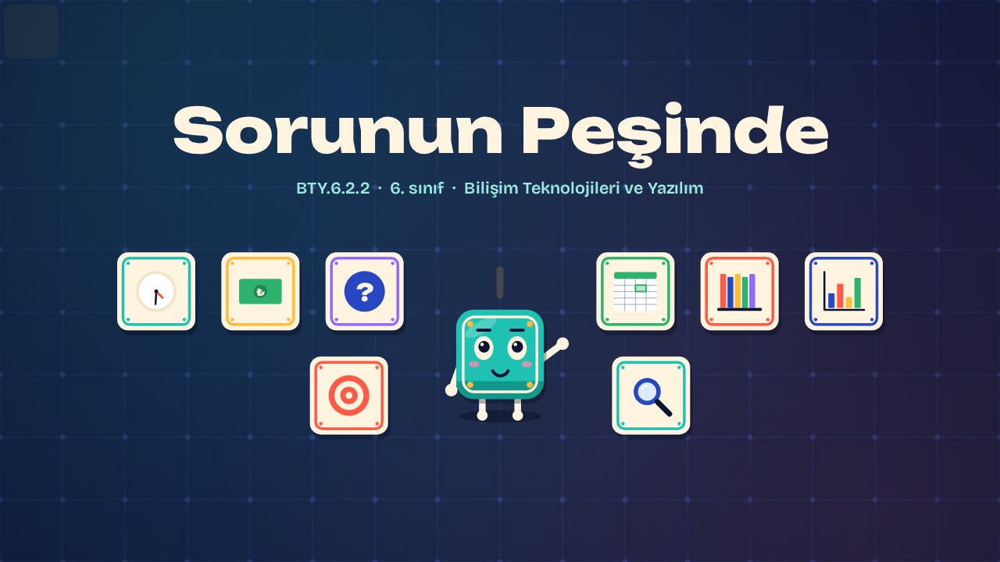
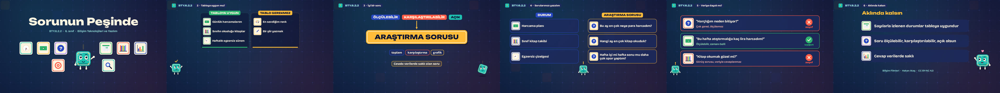

# Sorunun Peşinde · Chasing the Question

**▶ Tarayıcıda izleyin / Watch in the browser:** https://hakanatas.github.io/sorunun-pesinde/ 
**⬇ MP4 + altyazılar / MP4 + subtitles:** [Releases](https://github.com/hakanatas/sorunun-pesinde/releases) 
**✎ Kullanılan istem / The prompt behind it:** [PROMPT.md](PROMPT.md) 
**🎞 Bütün filmler / All films:** [Bilişim Filmleri](https://hakanatas.github.io/bilisim-filmleri/?sinif=6)

> **TR —** 6. sınıf Bilişim Teknolojileri ve Yazılım dersinin "Dijital Ürün Tasarımı ve Geliştirme" temasındaki BTY.6.2.2 öğrenme çıktısı için hazırlanmış, tamamen JavaScript ile çizilen 2,2 dakikalık animasyon; ses efektleri ve hafif fon müziği de kodla üretilir. Günlük harcama planı, sınıf kitap takibi ve haftalık egzersiz çizelgesi gibi durumlardan hangilerinin tablolama programıyla çözülmeye uygun olduğu belirlenir. İyi bir araştırma sorusunun özellikleri (ölçülebilir, karşılaştırılabilir, açık) tanıtılır. Her gerçek yaşam durumu için veriyle cevaplanabilecek araştırma soruları yazılır. Son olarak örnek sorular veriye dayalı olup olmadıklarına göre değerlendirilir. Altyazılar Türkçe, İngilizce ya da ikisi birlikte seçilebilir.

A 2.2-minute animation, with code-generated sound, for **6th-grade IT and Software** (Türkiye Yüzyılı Maarif Modeli). Karo decides which real-life situations suit a spreadsheet, learns what makes a good research question (measurable, comparable, clear), writes data-driven questions for each situation and judges example questions. The guide is **Karo**, a living glazed tile who never speaks: he tells the story with his face, his arms and the blinking cursor above his head.

## Öğrenme çıktısı · Learning outcome

MEB, Türkiye Yüzyılı Maarif Modeli, Bilişim Teknolojileri ve Yazılım Dersi Öğretim Programı, 6. sınıf, 2. tema "Dijital Ürün Tasarımı ve Geliştirme":

**BTY.6.2.2. Tablolama programlarının kullanımına yönelik problemleri belirleyebilme**
- a) Tablolama programlarının kullanımına uygun gerçek yaşam durumunu belirler.
- b) Bağlam içerisinde veriye dayalı cevaplanabilecek araştırma soruları oluşturur.

## Sahneler · Scenes

| # | Zaman | Sahne | Ne oluyor | Çıktı |
|---|---|---|---|---|
| 1 | 0:00–0:17 | Giriş |  |  |
| 2 | 0:17–0:41 | Tabloya uygun mu? | Tablolama programının kullanımına uygun gerçek yaşam durumları. | a |
| 3 | 0:41–1:10 | İyi bir soru | Veriye dayalı araştırma sorusunun özellikleri. | b |
| 4 | 1:10–1:33 | Sorularımızı yazalım | Her durum için veriye dayalı araştırma soruları. | b |
| 5 | 1:33–1:55 | Veriye dayalı mı? | Örnek sorular veriyle cevaplanıp cevaplanamayacağına göre değerlendirilir. | b |
| 6 | 1:55–2:11 | Aklında kalsın |  |  |

## Çalıştırma · Running it

- **Önizleme:** `index.html` dosyasına çift tıklayın (çevrim dışı da çalışır). Klavye: boşluk oynat/duraklat, ← → 3 sn, Home başa. Adrese `?altyazi=en`, `?bicim=vertical` ya da `?ses=0` eklenebilir.
- **MP4:** bir kez `npm install`, sonra `npm run export -- --format=both --captions=tr` (720p yatay ve dikey, sesli). Google Chrome yüklüyse Playwright onu kullanır (`channel: 'chrome'`); ffmpeg gerekir.
- **Altyazı ve seslendirme notları:** `npm run srt` → `out/sorunun-pesinde_tr.srt`, `_en.srt`, `_tr-en.srt`, `_seslendirme-notlari.txt`.
- **Sürüm dosyaları:** `npm run release` → `release/` klasöründe v1.0'ın 6 dosyası.
- **Yazı kontrolü:** `npm run check` yatay ve dikey düzende, üç altyazı seçeneğiyle üst üste binen, kenardan taşan ya da 720p'de 17 pikselden küçük kalan yazı arar.
- **Düzenleme:** senaryo (sahneler, altyazılar, seslendirme notları) `scenes/film.js` içindedir; değiştirince `npm run build` süreleri, `captions.js` ve `film.config.js` dosyalarını yeniden üretir. Sahne şablonları `src/kit/`, Karo `src/draw/karo.js`, ses `src/audio/synth.js`.

Her kare `renderFrame(t)` ile zamanın saf fonksiyonu olarak çizilir; rastgelelik tohumludur, MP4 ekran kaydı değil kare kare üretimdir. Ses de dosyadan çalınmaz: aynı olay listesinden hesaplanır. Yazı tipleri: Unbounded ve Bricolage Grotesque (SIL OFL 1.1), dosyaya gömülü.

## Lisans · License

**TR —** Bu film ve kodu [Creative Commons Atıf-GayriTicari 4.0 Uluslararası (CC BY-NC 4.0)](https://creativecommons.org/licenses/by-nc/4.0/deed.tr) lisansıyla paylaşılır. Ticari olmayan her amaçla (derste, okulda, eğitim materyalinde) kopyalayabilir, paylaşabilir ve değiştirebilirsiniz; ancak **kaynak göstermek zorunludur**: eser sahibinin adı ve bu deponun bağlantısı belirtilmeden kullanılamaz. Ticari kullanım (satış, ücretli ürün ya da yayın) için izin alınmalıdır.

**EN —** This film and its code are licensed under [Creative Commons Attribution-NonCommercial 4.0 International (CC BY-NC 4.0)](https://creativecommons.org/licenses/by-nc/4.0/). You may copy, share and adapt them for non-commercial purposes, but **attribution is required**: they may not be used without crediting the author and linking to this repository. Commercial use requires permission.

Atıf örneği / Required credit: *“Sorunun Peşinde”, Hakan Ataş, Bilişim Filmleri — https://github.com/hakanatas/sorunun-pesinde — CC BY-NC 4.0*
